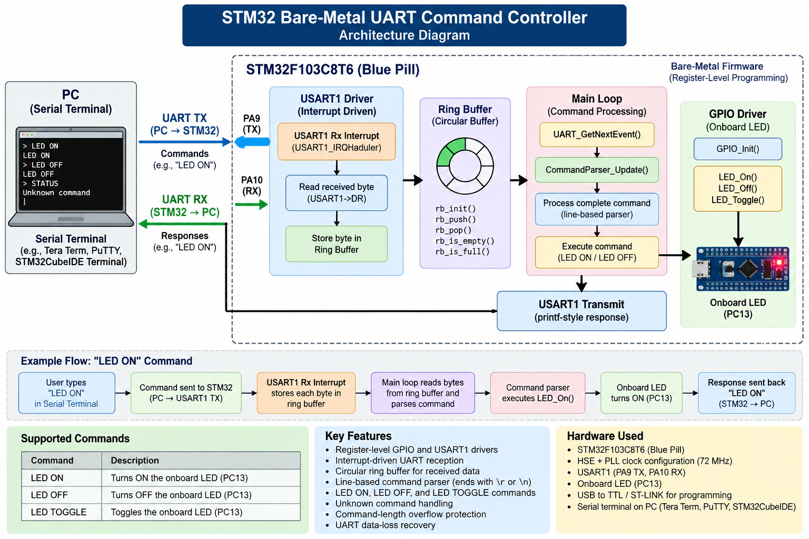

# STM32 Bare-Metal UART Command Controller

Bare-metal firmware for the **STM32F103C8T6 Blue Pill**, written in Embedded C without HAL or CubeMX-generated peripheral code. This project uses direct register-level programming to implement UART communication, interrupt-driven reception, a ring buffer, and a command parser to control the onboard LED.

**Author:** Venu S  
**Microcontroller:** STM32F103C8T6 (ARM Cortex-M3)  
**IDE:** STM32CubeIDE  
**Compiler:** ARM GCC  
**UART:** USART1, 9600 baud  
**Development status:** UART command controller implemented; hardware verification in progress.

## Project Goals

- Learn bare-metal Embedded C and memory-mapped peripheral registers.
- Configure the system clock and GPIO without HAL.
- Implement UART transmission and interrupt-driven reception.
- Use a ring buffer to separate interrupt handling from command processing.
- Build a modular, line-based command parser.
- Handle unknown commands, command overflow, and receive-buffer data loss.
- Develop a foundation for future sensor-monitoring firmware.

## Features

| Feature | Status |
|---|---|
| GPIO driver for onboard LED | ✅ Complete |
| HSE and PLL clock configuration | ✅ Complete |
| USART1 transmission | ✅ Complete |
| USART1 interrupt-driven reception | ✅ Complete |
| UART receive ring buffer | ✅ Complete |
| Line-based command parser | ✅ Complete |
| `LED ON` and `LED OFF` commands | ✅ Complete |
| Unknown-command handling | ✅ Complete |
| Command-length overflow handling | ✅ Complete |
| UART data-loss recovery | ✅ Complete |
| Physical-board verification | ✅ Complete |ned |
| Additional commands | Planned |

## System Architecture


```text
Computer / Serial Terminal
          |
          | UART commands
          v
       USART1
     PA10 RX / PA9 TX
          |
          v
  UART Receive Interrupt
   USART1_IRQHandler()
          |
          v
    Receive Ring Buffer
          |
          v
        main()
          |
          v
    Command Parser
          |
          v
      GPIO Driver
          |
          v
    Onboard LED (PC13)
          |
          v
   UART Response to PC
```

The UART interrupt stores incoming characters in the ring buffer. The main loop retrieves them and passes them to the command parser. The parser executes recognized commands and sends responses through UART.

## Hardware Connections

| STM32 Pin | Function | Connection |
|---|---|---|
| PC13 | GPIO output | Onboard LED, active-low |
| PA9 | USART1 TX | USB-to-UART adapter RX |
| PA10 | USART1 RX | USB-to-UART adapter TX |
| GND | Ground | USB-to-UART adapter GND |
| PA13 | SWDIO | ST-LINK V2 SWDIO |
| PA14 | SWCLK | ST-LINK V2 SWCLK |
| GND | Ground | ST-LINK GND |

Use a 3.3 V-compatible UART adapter. Connect TX to RX and RX to TX, and ensure the devices share a ground.

## Clock Configuration

The firmware configures the STM32 clock using an 8 MHz external high-speed oscillator (HSE) and a PLL multiplier of 9.

| Clock | Configuration | Frequency |
|---|---|---:|
| HSE | External crystal | 8 MHz |
| PLL | HSE × 9 | 72 MHz |
| SYSCLK | PLL output | 72 MHz |
| AHB / HCLK | SYSCLK / 1 | 72 MHz |
| APB1 | AHB / 2 | 36 MHz |
| APB2 | AHB / 1 | 72 MHz |

USART1 is connected to APB2. Its baud-rate register is configured for 9600 baud using a 72 MHz peripheral clock.

## UART Command Interface

The firmware supports the following commands through a serial terminal.

| Input | Action | Response |
|---|---|---|
| `LED ON` | Turn the onboard LED on | `LED is ON` |
| `LED OFF` | Turn the onboard LED off | `LED is OFF` |
| Any unsupported command | Reject the command | `Unknown command` |
| Command exceeding buffer capacity | Reject the command | `Error: Command too long` |

Commands are terminated by a newline character. The parser ignores carriage returns, allowing it to work with common terminal line-ending settings.

### Example Terminal Session

```text
UART Command Parser Ready

LED ON
LED is ON

LED OFF
LED is OFF

HELLO
Unknown command
```

## How `LED ON` Works

1. The computer sends `LED ON` through the serial adapter.
2. USART1 receives the characters on PA10.
3. The RXNE interrupt triggers when a received character is ready.
4. `USART1_IRQHandler()` reads the data register and stores the character in the receive ring buffer.
5. The main loop calls `UART_GetNextEvent()` to retrieve characters.
6. `CommandParser_Update()` collects characters until a newline is received.
7. `ProcessCommand()` compares the completed command with `LED ON`.
8. `GPIO_Set()` drives PC13 low, turning on the active-low LED.
9. `UART_SendString()` sends `LED is ON` back to the terminal.

## Register-Level Programming

This project avoids HAL and LL peripheral drivers. Peripheral configuration is performed using memory-mapped registers, bitwise operations, and explicit clock control.

The current source uses a custom register header, `stm32f103_regs.h`, to access STM32 registers.

### Example: Configure PC13 as an Output

```c
/* Enable the GPIOC peripheral clock */
RCC_APB2ENR |= (1U << 4);

/* Configure PC13 as a 10 MHz push-pull output */
GPIOC_CRH &= ~(0xFU << 20);
GPIOC_CRH |=  (0x1U << 20);
```

PC13 is the onboard LED pin on the Blue Pill. The LED is active-low: driving the pin low turns it on, and driving it high turns it off.

### Example: Configure USART1 Pins

```c
/* Enable GPIOA and USART1 clocks */
RCC_APB2ENR |= (1U << 2);
RCC_APB2ENR |= (1U << 14);

/* PA9: Alternate-function push-pull output */
GPIOA_CRH &= ~(0xFU << 4);
GPIOA_CRH |=  (0xBU << 4);

/* PA10: Floating input */
GPIOA_CRH &= ~(0xFU << 8);
GPIOA_CRH |=  (0x4U << 8);
```

The firmware configures USART1 for 9600 baud, enables the transmitter and receiver, enables the RXNE interrupt, and enables the USART1 interrupt in the NVIC.

## Ring Buffer and Interrupt Handling

The UART receive driver uses a 64-byte circular buffer.

- The interrupt handler acts as the producer and stores received characters.
- The main loop acts as the consumer and retrieves characters.
- `rx_head` tracks where the next character will be stored.
- `rx_tail` tracks the next character to be read.
- One buffer slot is reserved to distinguish full from empty, so the usable capacity is **63 characters**.
- If the buffer becomes full, incoming characters are dropped and a data-loss event is reported.
- The main loop briefly disables interrupts while accessing shared buffer state.

This design keeps the interrupt handler short and leaves command processing to the main loop.

## Project Structure

```text
STM32_Sensor_Monitor/
├── Core/
│   └── Src/
│       ├── main.c
│       ├── clock.c
│       ├── gpio.c
│       ├── uart.c
│       └── command_parser.c
├── Core/
│   └── Inc/
│       ├── clock.h
│       ├── gpio.h
│       ├── uart.h
│       ├── command_parser.h
│       └── stm32f103_regs.h
└── README.md
```

Adjust the directory tree to match the actual repository layout.

## Build and Test

1. Open the project in STM32CubeIDE.
2. Build the project using the ARM GCC toolchain.
3. Connect the ST-LINK V2 to the Blue Pill using SWD.
4. Connect a USB-to-UART adapter to PA9, PA10, and GND.
5. Open a serial terminal at **9600 baud, 8 data bits, no parity, 1 stop bit (8-N-1)**.
6. Flash the firmware and reset the board.
7. Confirm the startup message appears.
8. Send `LED ON` and `LED OFF` and verify the LED and terminal responses.
9. Test unknown commands and commands that exceed the parser's capacity.

Hardware testing should be marked complete only after these checks succeed on the physical board.

## Future Improvements

- Implement a TIM2 periodic interrupt.
- Add ADC support for sensor measurements.
- Add `HELP` and `STATUS` commands.
- Expand the firmware into a sensor-monitoring application.
- Improve peripheral error handling and hardware test coverage.

## Learning Outcomes

This project provides practical experience with:

- Embedded C and bitwise operations.
- ARM Cortex-M3 and memory-mapped I/O.
- Clock configuration and peripheral clock gating.
- GPIO and USART register configuration.
- Interrupt service routines and NVIC.
- Circular buffers and shared data between ISR and main code.
- Modular firmware architecture and command parsing.
- Hardware debugging with ST-LINK and a serial terminal.
